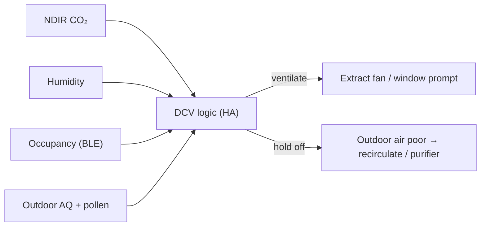

# Indoor Air Quality Monitoring and Demand-Controlled Ventilation (WIP)

**Monitoring indoor air quality the way a BMS does: CO₂, VOCs, particulates, temperature and humidity per room, alongside outdoor air quality and pollen, with alarm bands and planned demand-controlled ventilation (DCV) logic. Part of the work is being honest about sensor technology: a cheap "CO₂" sensor that actually estimates CO₂ from VOCs is replaced with a true NDIR sensor.**

> **The short version:**
> - **Live now:** Zigbee temperature/humidity sensors across the house; a Zigbee CO₂/VOC sensor (flaky, and *estimated* CO₂); a PM2.5 monitor; an indoor environment module on the weather station; outdoor air-quality and pollen feeds.
> - **Next:** a **true NDIR CO₂ sensor** on ESPHome, IAQ bands and alerts, then **DCV logic**: ventilate when CO₂ or humidity rises, hold off when outdoor air or pollen is poor.

**Portfolio position:** Automation level · IAQ and ventilation control. Related: [ESP32 BLE presence](https://github.com/the-control-cabinet/esp32-ble-presence-network) (occupancy input) · [Zigbee network](https://github.com/the-control-cabinet/zigbee-network-migration-z2m) · [HA integration schedule](https://github.com/the-control-cabinet/home-assistant-integration-schedule)

---

## 1. Why IAQ matters (the BMS view)
- **CO₂** is the standard proxy for occupancy-driven ventilation need. Outdoor air is about 420 ppm, and indoor levels rise with people and poor ventilation.
- **Humidity** drives condensation and mould risk, and comfort.
- **PM2.5 and VOCs** come from cooking, cleaning, candles and outdoor pollution.
- In commercial buildings this is **demand-controlled ventilation**: ventilate to need, not to a fixed schedule, saving energy while protecting air quality.

## 2. Points list

| Point | Source | Type | Status |
|---|---|---|---|
| Room temperature / humidity (multiple rooms) | Zigbee sensors | AI | ✅ Live |
| CO₂ (estimated) + VOC | Zigbee CO₂/VOC sensor (generic Tuya) | AI | ⚠️ Live but flaky (stale reports; reporting throttled to 60 s) |
| PM2.5 | Air-quality monitor | AI | ✅ Live |
| Indoor CO₂ / humidity / noise | Weather-station indoor module (vendor cloud) | AI | ✅ Live |
| Outdoor air quality index | Public air-quality API | AI | ✅ Live |
| Pollen | Public pollen API | AI | ✅ Live |
| **True CO₂ (NDIR)** | ESPHome ESP32 + NDIR sensor (SCD4x or SenseAir S8 class) | AI | 📐 Planned |
| Room occupancy | BLE presence (Bermuda) | DI | ✅ Live (other repo) |
| Ventilation command | Extract fans / window prompt | DO / notify | 📐 Planned |

Data: [data/iaq-points.csv](data/iaq-points.csv)

## 3. Sensor technology: estimated vs real CO₂
Many low-cost "CO₂" sensors use a **metal-oxide (MOX) VOC sensor** and report an **estimated "eCO₂"**. It moves with VOCs (cooking, cleaning products, perfume), not with actual CO₂, so it can't reliably drive ventilation.

| Technology | Measures | Use |
|---|---|---|
| MOX / eCO₂ | VOCs, then estimates CO₂ | VOC trend only |
| **NDIR** (e.g. Sensirion SCD4x, SenseAir S8) | **Actual CO₂** by infrared absorption | Ventilation control |

**Action:** keep the existing sensor for **VOC trends**, and add an **NDIR CO₂** sensor on an ESPHome board for any control decisions ([config example](config/esphome-ndir-co2.example.yaml)).

## 4. IAQ bands and alarms

| Measure | Good | Moderate | Poor | Action |
|---|---|---|---|---|
| CO₂ (ppm) | < 800 | 800-1,200 | > 1,200 | Ventilate; alert above 1,500 |
| Relative humidity (%) | 40-60 | 30-40 / 60-70 | < 30 / > 70 | Extract above 70 % for 30 min (mould risk) |
| PM2.5 (µg/m³) | < 10 | 10-25 | > 25 | Purifier on; avoid ventilating if outdoor PM is higher |
| VOC (index) | low | rising | high | Ventilate after cooking/cleaning |

The bands are typical guidance values, to be tuned per room. Example automations: [config/iaq-alerts.example.yaml](config/iaq-alerts.example.yaml)

## 5. Demand-controlled ventilation (planned)

Rules (draft):
1. **Ventilate** when CO₂ > 1,000 ppm **and** the room is occupied, or RH > 70 % for 30 min.
2. **Hold off** outdoor air when the outdoor AQ index or pollen is high. Use the purifier and prompt instead.
3. **Hysteresis:** stop at CO₂ < 800 ppm / RH < 60 %, with a minimum run time to avoid cycling.
4. **Heating interlock:** a window prompt while heating is calling is flagged, to save energy (ties into the Evohome data).

## 6. Issues and lessons
- **Flaky Zigbee CO₂/VOC sensor:** stale "failed: lqi" reports, a router-path problem, plus chatty reporting. Fixed with a reporting throttle (60 s); mesh routing is under review.
- **Estimated CO₂ isn't CO₂:** the main lesson. The sensor's technology determines what it can control.

## 7. Roadmap
- [ ] Add an NDIR CO₂ sensor (ESPHome), calibrated against outdoor air (~420 ppm).
- [ ] IAQ dashboard (per room) and alerts.
- [ ] DCV automations with outdoor AQ and pollen hold-off.
- [ ] Link to occupancy and the heating interlock.

## 8. Skills demonstrated

| Skill | Evidence |
|---|---|
| IAQ points list and bands | CO₂, RH, PM2.5, VOC with alarm thresholds |
| Sensor technology selection | MOX/eCO₂ vs NDIR, and why it matters for control |
| DCV control design | Multi-input logic with hold-off, hysteresis and minimum run time |
| Integration | Zigbee, ESPHome, cloud and public APIs in one view |

📺 [The Control Cabinet on YouTube](https://www.youtube.com/channel/UC5Cupmz7vlfcodpCX7k8iuQ)

*Built and documented by James · part of [The Control Cabinet BMS portfolio](https://github.com/the-control-cabinet). MIT Licence.*
